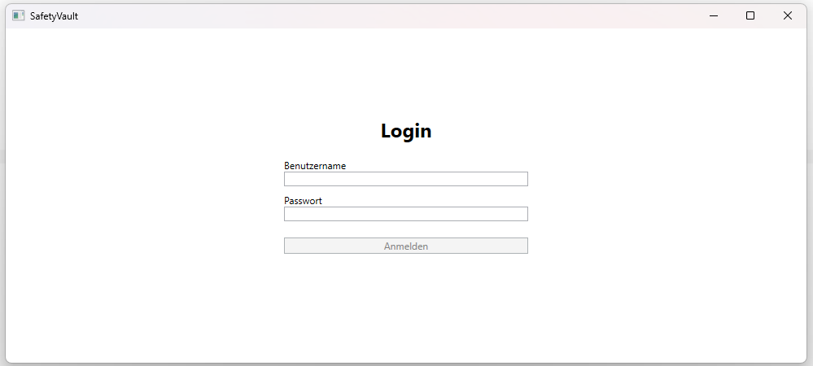
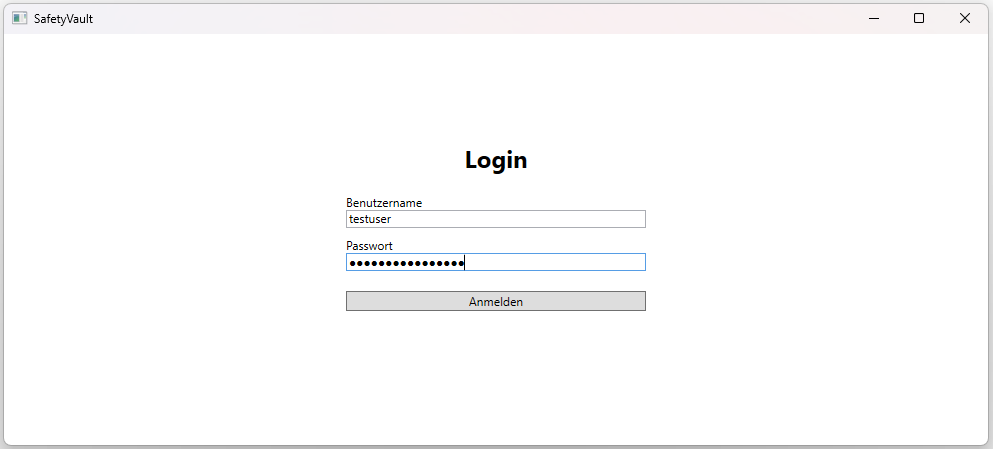
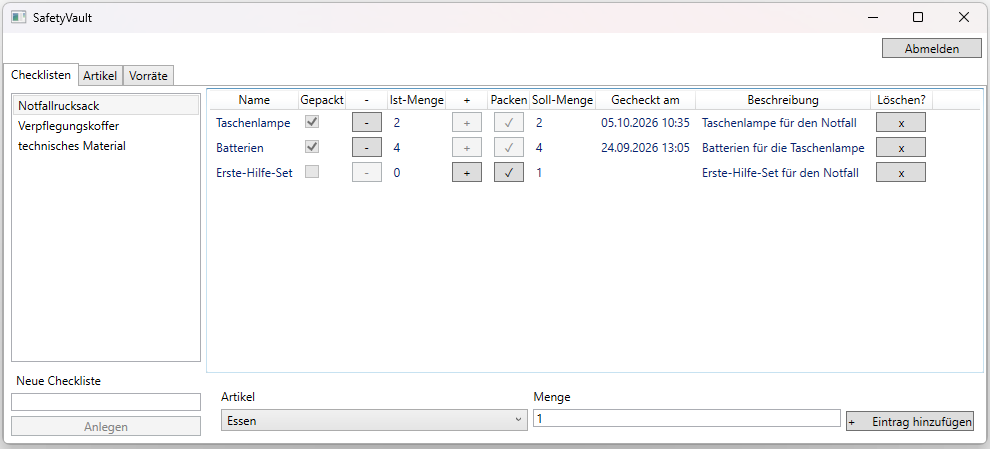
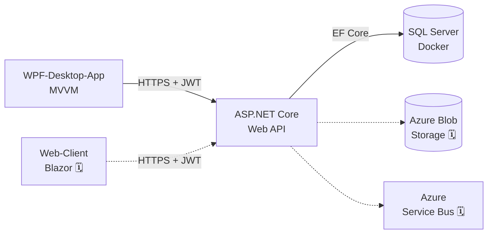

# SafetyVault

SafetyVault hilft dabei, auf Notfälle vorbereitet zu sein: Es verwaltet Checklisten für
Notfallrucksäcke, behält die Haltbarkeit von Vorräten im Blick und soll wichtige Dokumente
verschlüsselt speichern, damit man sie im Ernstfall von überall abrufen kann.

Das Projekt entstand als Übungsprojekt zur Vorbereitung auf meine Abschlussprüfung als
Fachinformatiker für Anwendungsentwicklung. Es vereint eine WPF-Desktop-App (MVVM) mit einer ASP.NET Core Web API,
einer SQL-Server-Datenbank im Docker-Container und JWT-Authentifizierung. Geplant sind ein
Web-Client für das Smartphone und die Anbindung an Azure.

## Funktionen

| Modul              | Beschreibung                                                                                                          | Stand      |
| ------------------ | --------------------------------------------------------------------------------------------------------------------- | ---------- |
| Checklisten        | Eigene Checklisten anlegen, Artikel mit Soll- und Ist-Menge zuordnen und als gepackt abhaken                          | ✅ fertig  |
| Vorräte            | Chargen mit Menge und Mindesthaltbarkeitsdatum erfassen; eine Ampel zeigt, was bald abläuft                           | ✅ fertig  |
| Benutzerkonten     | Registrierung und Anmeldung per JWT, Login und Logout im Desktop-Client; jeder Benutzer sieht nur seine eigenen Daten | ✅ fertig  |
| Dokumenten-Tresor  | Wichtige Unterlagen verschlüsselt in der Cloud (Azure Blob Storage) ablegen                                           | 🗓️ geplant |
| Web-Zugriff        | Checklisten und Dokumente unterwegs per Smartphone oder Browser abrufen (Blazor)                                      | 🗓️ geplant |
| Benachrichtigungen | Hinweise auf ablaufende Vorräte (Azure Service Bus)                                                                   | 🗓️ geplant |

## Screenshots

| Anmeldung                                    | Checklisten                                             | Vorräte                                                    |
| -------------------------------------------- | ------------------------------------------------------- | ---------------------------------------------------------- |
|  |  |  |

## Architektur

Ein zentrales Backend versorgt alle Clients. Die Clients greifen nie direkt auf die Datenbank zu,
sondern nur über die API.



Gemeinsame Datenmodelle (DTOs) und Regeln liegen im Projekt `SafetyVault.Shared` und werden
von API und Clients genutzt.

## Tech-Stack

**Umgesetzt**

- C# / .NET 10
- WPF mit MVVM-Muster
- ASP.NET Core Web API (REST)
- Entity Framework Core (Code-First, Migrationen)
- MS SQL Server 2022 im Docker-Container, Docker Compose, Portainer
- Authentifizierung mit JWT, Kennwörter als Hash
- Unit-Tests mit xUnit
- Git & GitHub

**Geplant 🗓️**

- Blazor (Web-Client)
- Azure Blob Storage, Azure Service Bus, Azure App Service
- Containerisierung der API & CI/CD mit GitHub Actions
- Integrationstests

## Technische Schwerpunkte

- **MVVM ohne Framework:** eigene `RelayCommand`- und `AsyncRelayCommand`-Klassen sowie ein
  Dialog-Service. Die Logik bleibt so unabhängig von der Oberfläche und testbar.
- **Getrennte DTOs je Richtung:** Eingabe- und Ausgabemodelle sind getrennt. Das schützt vor
  Overposting (Clients können keine Felder setzen, die sie nicht setzen dürfen).
- **Result Pattern:** Services liefern ein Ergebnisobjekt statt HTTP-Statuscodes. Erst der
  Controller übersetzt es in `200`, `201`, `404` oder `409`.
- **Datenbank in 3. Normalform:** Abgeleitete Werte (z. B. „gepackt“ oder „Tage bis
  Ablauf“) werden berechnet statt gespeichert; Eindeutigkeit wird über Unique Indizes abgesichert.
- **Sicherheit:** Kennwörter nur als Hash, JWT mit Prüfung von Aussteller, Empfänger,
  Laufzeit und Signatur. Beim Login gibt es keine Hinweise darauf, ob ein Benutzer existiert.
- **Datenhoheit:** Jeder Benutzer sieht nur seine eigenen Daten. Die Benutzer-Id kommt ausschließlich
  aus dem geprüften Token, nie aus der Anfrage; fremde Datensätze werden mit `404` beantwortet
  (Schutz vor IDOR). Namen sind pro Benutzer eindeutig, damit keine Fehlermeldung fremde Daten verrät.
- **Login im Desktop-Client:** Der Token wird im gemeinsam genutzten `HttpClient` hinterlegt, Daten werden
  erst nach der Anmeldung geladen, und beim Abmelden werden Token und Eingabefelder geleert.
- **Keine Geheimnisse im Repo:** User Secrets und `.env`; die Git-Historie ist mit gitleaks geprüft.
  Bewusst ohne Demo-Benutzer mit festem Kennwort.
- **Testbare Zeit:** Datumslogik nutzt `TimeProvider`, damit Unit-Tests mit einer festen
  Uhr laufen.

## Lokal starten

### Voraussetzungen

- Windows mit [.NET 10 SDK](https://dotnet.microsoft.com/download) (der WPF-Client läuft nur unter Windows)
- [Docker Desktop](https://www.docker.com/products/docker-desktop/) für SQL Server
  (das SQL-Server-Image gibt es nur für x86-64; auf ARM-Rechnern einen lokal installierten SQL Server verwenden)
- EF-Core-Werkzeug: `dotnet tool install --global dotnet-ef`

### 1. Datenbank starten

```powershell
git clone https://github.com/DaKa1985/SafetyVault.git
cd SafetyVault
copy .env.example .env        # in .env ein eigenes, starkes sa-Kennwort eintragen
docker compose up -d
```

### 2. Geheimnisse der API setzen (User Secrets, landen nicht im Repo)

```powershell
# Verbindungszeichenfolge – Kennwort wie in .env
dotnet user-secrets set "ConnectionStrings:SafetyVaultDb" "Server=127.0.0.1,1433;Database=SafetyVault;User Id=sa;Password=<dein-Kennwort>;TrustServerCertificate=True" --project src\SafetyVault.Api

# Zufälliger Signaturschlüssel für JWT (64 Bytes, Base64)
$bytes = New-Object byte[] 64
[System.Security.Cryptography.RandomNumberGenerator]::Create().GetBytes($bytes)
dotnet user-secrets set "Jwt:SigningKey" ([Convert]::ToBase64String($bytes)) --project src\SafetyVault.Api
```

### 3. Datenbank anlegen und API starten

```powershell
dotnet dev-certs https --trust
dotnet ef database update --project src\SafetyVault.Api
dotnet run --project src\SafetyVault.Api --launch-profile https
```

Die API läuft dann unter `https://localhost:7247`.

### 4. Benutzer registrieren

Die Datenbank startet bewusst leer. In Visual Studio `src/SafetyVault.Api/auth.http` öffnen und die Anfrage
`POST /api/auth/register` mit eigenem Benutzernamen, eigener E-Mail und eigenem Kennwort senden (erwartet `201 Created`).

### 5. Desktop-Client starten

```powershell
dotnet run --project src\SafetyVault.Wpf
```

Mit dem registrierten Benutzer anmelden, eine Checkliste anlegen und loslegen.

### Tests

```powershell
dotnet test
```

## Fahrplan

- [x] Checklisten-Modul (API + WPF)
- [x] Datenbank mit EF Core und Docker
- [x] Vorrats-Modul mit Haltbarkeits-Ampel
- [x] Unit-Tests
- [x] Registrierung und Login mit JWT
- [x] Datenhoheit pro Benutzer, Login und Logout im WPF-Client
- [x] Eigene Checklisten anlegen
- [ ] Dokumenten-Tresor mit Verschlüsselung und Azure Blob Storage
- [ ] Web-Client mit Blazor (Dokumente und Checklisten abrufen)
- [ ] Benachrichtigungen über Azure Service Bus
- [ ] Integrationstests
- [ ] Containerisierung und Deployment nach Azure mit CI/CD-Pipeline
