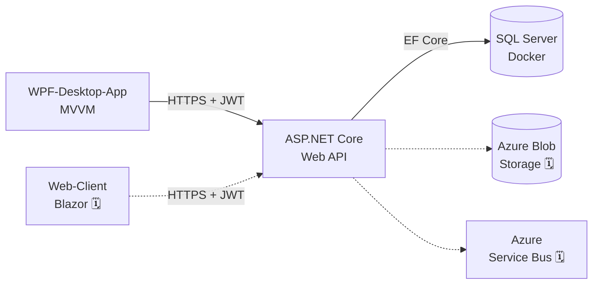

# SafetyVault

SafetyVault hilft dabei, auf Notfälle vorbereitet zu sein: Es verwaltet Checklisten für
Notfallrucksäcke, behält die Haltbarkeit von Vorräten im Blick und soll wichtige Dokumente
verschlüsselt speichern, damit man sie im Ernstfall von überall abrufen kann.

Das Projekt entstand als Übungsprojekt zur Vorbereitung auf meine Abschlussprüfung als
Fachinformatiker für Anwendungsentwicklung. Es vereint eine WPF-Desktop-App (MVVM) mit einer ASP.NET Core Web API,
einer SQL-Server-Datenbank im Docker-Container und JWT-Authentifizierung. Geplant sind ein
Web-Client für das Smartphone und die Anbindung an Azure.

## Funktionen

| Modul              | Beschreibung                                                                                              | Stand        |
| ------------------ | --------------------------------------------------------------------------------------------------------- | ------------ |
| Checklisten        | Notfallrucksäcke und Packlisten anlegen, Artikel mit Soll- und Ist-Menge zuordnen und als gepackt abhaken | ✅ fertig    |
| Vorräte            | Chargen mit Menge und Mindesthaltbarkeitsdatum erfassen; eine Ampel zeigt, was bald abläuft               | ✅ fertig    |
| Benutzerkonten     | Registrierung und Anmeldung per JWT; jeder Benutzer sieht nur seine eigenen Daten                         | 🚧 in Arbeit |
| Dokumenten-Tresor  | Wichtige Unterlagen verschlüsselt in der Cloud (Azure Blob Storage) ablegen                               | 🗓️ geplant   |
| Web-Zugriff        | Zugriff auf Checklisten und Dokumente unterwegs per Smartphone oder Browser (Blazor)                      | 🗓️ geplant   |
| Benachrichtigungen | Hinweise auf ablaufende Vorräte (Azure Service Bus)                                                       | 🗓️ geplant   |

## Architektur

Ein zentrales Backend versorgt alle Clients. Die Clients greifen nie direkt auf die Datenbank zu,
sondern nur über die API.

Gemeinsame Datenmodelle (DTOs) und Regeln liegen im Projekt `SafetyVault.Shared` und werden
von API und Clients genutzt.

## Tech-Stack

**Umgesetzt**

- C# / .NET 10
- WPF mit MVVM-Muster
- ASP.NET Core Web API (REST)
- Entity Framework Core (Code-First, Migrationen)
- MS SQL Server 2022 im Docker-Container, Docker Compose, Portainer
- Authentifizierung mit JWT, Kennwörter als Hash
- Unit-Tests mit xUnit
- Git & GitHub

**Geplant 🗓️**

- Blazor (Web-Client)
- Azure Blob Storage, Azure Service Bus, Azure App Service
- Containerisierung der API & CI/CD mit GitHub Actions
- Integrationstests

## Technische Schwerpunkte

- **MVVM ohne Framework:** eigene `RelayCommand`- und `AsyncRelayCommand`-Klassen sowie ein
  Dialog-Service. Die Logik bleibt so unabhängig von der Oberfläche und testbar.
- **Getrennte DTOs je Richtung:** Eingabe- und Ausgabemodelle sind getrennt. Das schützt vor
  Overposting (Clients können keine Felder setzen, die sie nicht setzen dürfen).
- **Result Pattern:** Services liefern ein Ergebnisobjekt statt HTTP-Statuscodes. Erst der
  Controller übersetzt es in `200`, `404` oder `409`.
- **Datenbank in 3. Normalform:** Abgeleitete Werte (z. B. „gepackt“ oder „Tage bis
  Ablauf“) werden berechnet statt gespeichert; Eindeutigkeit wird über Unique Indizes abgesichert.
- **Sicherheit:** Kennwörter nur als Hash, JWT mit Prüfung von Aussteller, Empfänger,
  Laufzeit und Signatur. Beim Login gibt es keine Hinweise darauf, ob ein Benutzer existiert.
- **Datenhoheit:** Jeder Benutzer sieht nur seine eigenen Daten. Fremde Datensätze werden
  mit `404` beantwortet (Schutz vor IDOR). _(in Arbeit)_
- **Keine Geheimnisse im Repo:** User Secrets und `.env`; die Git-Historie ist mit gitleaks geprüft.
- **Testbare Zeit:** Datumslogik nutzt `TimeProvider`, damit Unit-Tests mit einer festen
  Uhr laufen.

## Fahrplan

- [x] Checklisten-Modul (API + WPF)
- [x] Datenbank mit EF Core und Docker
- [x] Vorrats-Modul mit Haltbarkeits-Ampel
- [x] Unit-Tests
- [x] Registrierung und Login mit JWT
- [ ] Datenhoheit pro Benutzer und Login im WPF-Client
- [ ] Dokumenten-Tresor mit Verschlüsselung und Azure Blob Storage
- [ ] Web-Client mit Blazor
- [ ] Benachrichtigungen über Azure Service Bus
- [ ] Integrationstests
- [ ] Containerisierung und Deployment nach Azure mit CI/CD-Pipeline
